# 简历优化工作台

一个完全跑在本机的简历优化工具：录入一份简历 + 若干目标单位，批量调用 AI 为每个单位生成一版定制简历，逐份微调后导出 PDF。

目标单位只需要填**名称和招聘要求**——单位简介、重点考察范围、注意事项、语气偏好由程序
自行搜索并推断补齐（见[单位情报是怎么来的](#单位情报是怎么来的)）。

所有数据都只存在本机 `data/` 目录，不上传任何服务器。发给 AI 的内容会先做脱敏，AI 返回后再把真实信息还原回来。

## 启动

```bash
cd /data/dsh/home/简历优化
node server.js          # 默认监听 0.0.0.0:8888
```

浏览器打开 <http://127.0.0.1:8888>。

- 换端口：`PORT=9000 node server.js`（`HOST` 同理）
- 停止：`node test/stop.js`（只停某个端口用 `node test/stop.js 8901`）
- 不需要 `npm install`：没有任何第三方依赖，只用 Node 内置模块

要求 Node ≥ 20。

导出 PDF 由项目自带的排版引擎生成（`lib/pdf/`），**不需要浏览器**：直接读系统
字体文件做子集化嵌入，纯 JS 写出 PDF，单份约 20ms。字体按以下顺序查找：

1. 环境变量 `PDF_FONT_ZH` 指向的字体（可配 `PDF_FONT_ZH_FACE` 选 TTC 里的 face）
2. `/data/dsh/tools/headless/fonts/root/fonts-wqy-zenhei/.../wqy-zenhei.ttc`
3. 常见系统路径（Noto Sans CJK、Source Han Sans、SimHei、SimSun 等）

都找不到时自动退回无头 Chrome 打印（需要 `/data/dsh/tools/headless/bin/chrome-headless-shell`），
两条路都不可用时页面会提示，HTML 与 Markdown 导出不受影响。
强制指定引擎：`PDF_ENGINE=chrome node server.js`。

## 登录认证

首次打开会跳到 `/login.html`,先设一个账号密码;之后每次打开都要登录,所有页面、静态资源
和接口都要通过认证才能访问——只有登录页本身和"查询状态 / 初始化 / 登录"三个接口是公开的。

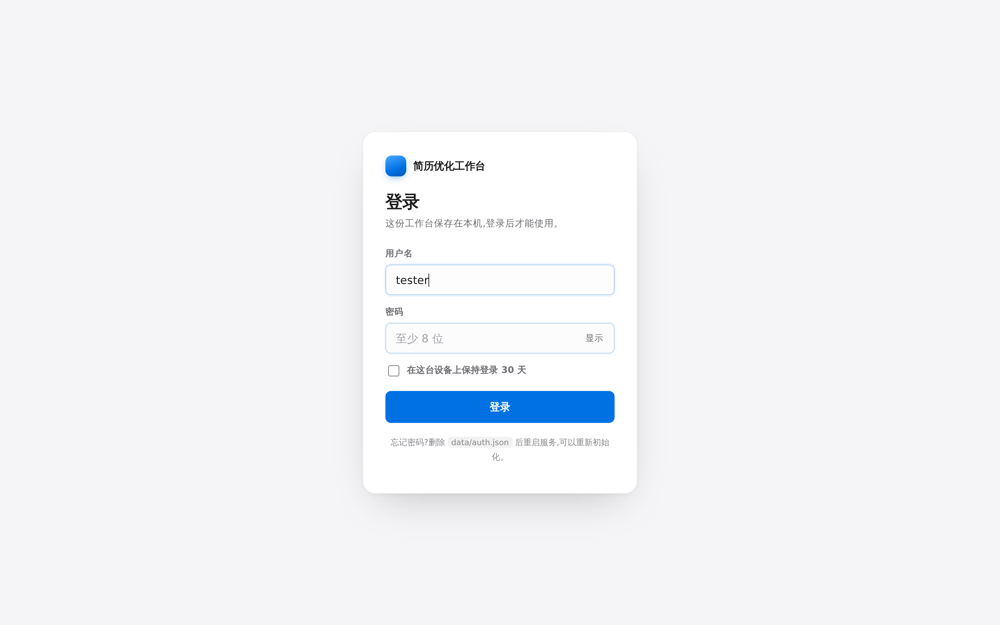

手机上是同一套表单:输入框 16px(避免 iOS 聚焦自动放大),卡片按屏宽收窄。

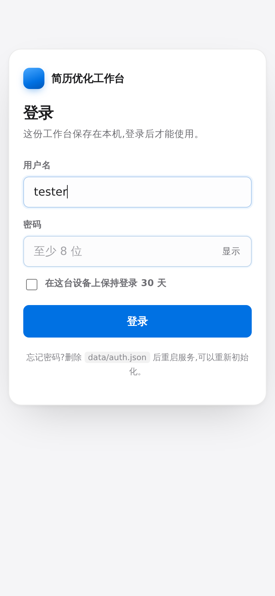

- **密码怎么存**:`data/auth.json` 里只存 scrypt(N=16384, r=8, p=1)加盐哈希,**不留明文**;
  文件权限 `600`,只有本机当前用户能读
- **会话**:签名 cookie(`HttpOnly` + `SameSite=Lax`),默认 7 天,勾选"保持登录"30 天;
  剩余寿命不到一半时自动续签,不会写着写着被踢出去
- **锁定**:同一 IP 连续 5 次输错,锁 5 分钟(过反向代理时按 `X-Forwarded-For` 首段判断)
- **改密码**:顶栏右上角「账户」→ 改密码。改完会轮换签名密钥,**其它设备上的登录立即失效**,
  当前这一端自动换发新 cookie
- **忘了密码**:删掉 `data/auth.json` 再重启服务,会重新进入"设置账号"流程;简历数据不受影响

```bash
rm data/auth.json && node server.js   # 重新设置账号
```

把工作台放到反向代理后面时,记得开启 `X-Forwarded-For`,否则所有人共用一个锁定计数。

## 界面

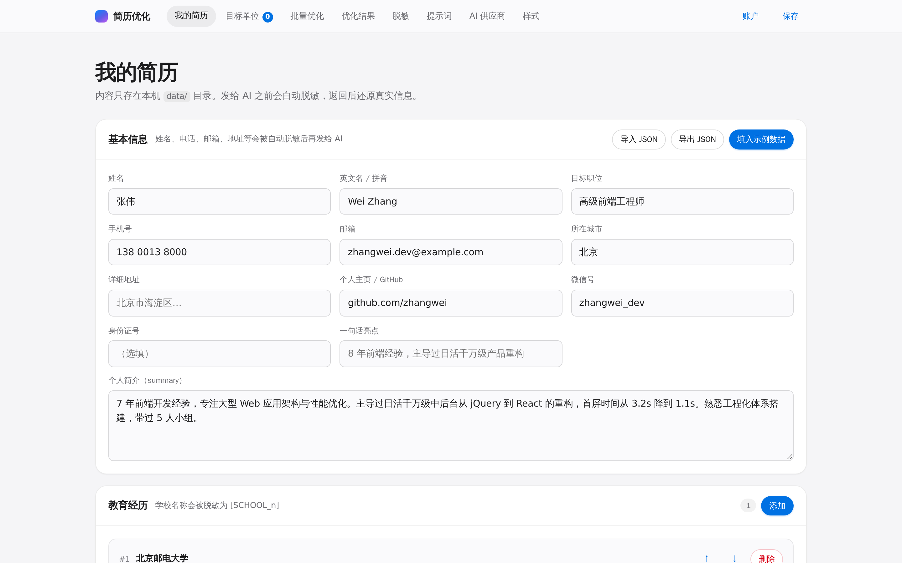

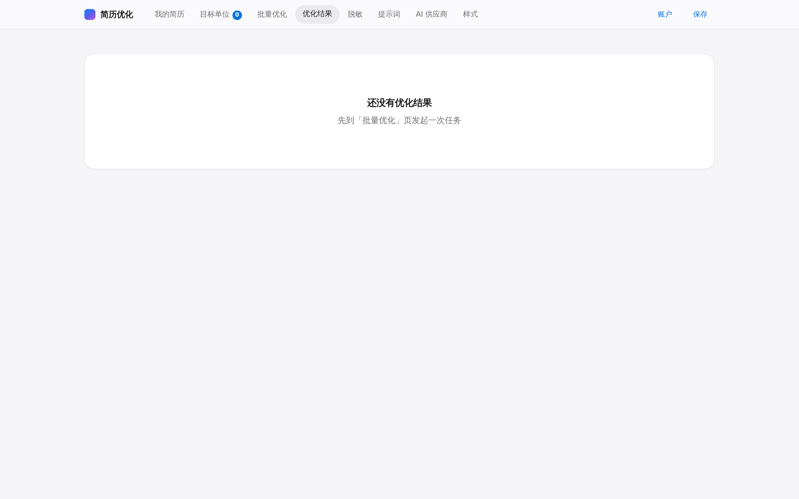

## 八个页签

| 页签 | 作用 |
| --- | --- |
| 我的简历 | 结构化录入：基本信息、教育、工作、项目、技能、获奖、证书、自定义板块；支持导入/导出 JSON、填入示例 |
| 目标单位 | **只填单位名称 + 招聘要求**，其余（单位简介、重点考察范围、注意事项、语气偏好）由程序搜索补齐 |
| 批量优化 | 勾选多个单位 → 选模板与供应商 → 一次跑完；可随时取消，单条失败不影响其它条 |
| 优化结果 | 每份结果的预览、就地编辑、AI 改动说明、关键词、导出 PDF/HTML/MD、纯文本复制、重新生成 |
| 脱敏设置 | 打开/关闭各类敏感信息、自定义字面量或正则规则、实时对比"原文 vs 实际发给 AI 的内容" |
| 提示词 | 编辑模板正文与系统提示词，每次保存留档，最多保留 10 条历史版本可随时恢复 |
| AI 供应商 | 保存多个供应商（OpenAI / Anthropic 协议），一键切换、测试连接、复制配置 |
| 样式 | 12 套主题画廊、逐段版式（标题样式/位置/对齐/符号/字号/顺序/隐藏）、头部与排版、自定义 CSS（**可以让 AI 按一句话生成**）、实时预览与导出 |

手机浏览器上直接用就行：页签改成可横滑的一行，按钮和输入框放大到手指点得准的尺寸
（输入框 16px 字号，避免 iOS 聚焦时自动放大页面），弹窗变成整屏面板，
排版调节这类多列控件在窄屏上自动改成两段竖排。简历预览在窄屏上保留纸张的边距、圆角和阴影，
但放弃 210mm 的固定宽度、按容器重排——把 794px 宽的纸塞进 320px 的框里，只能横着滚着看。


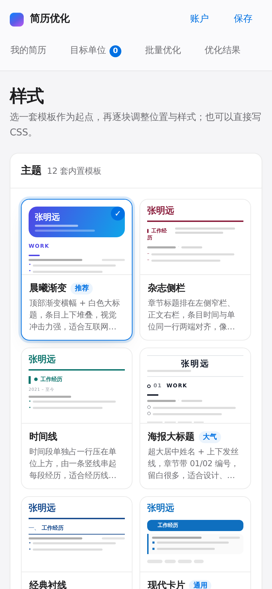
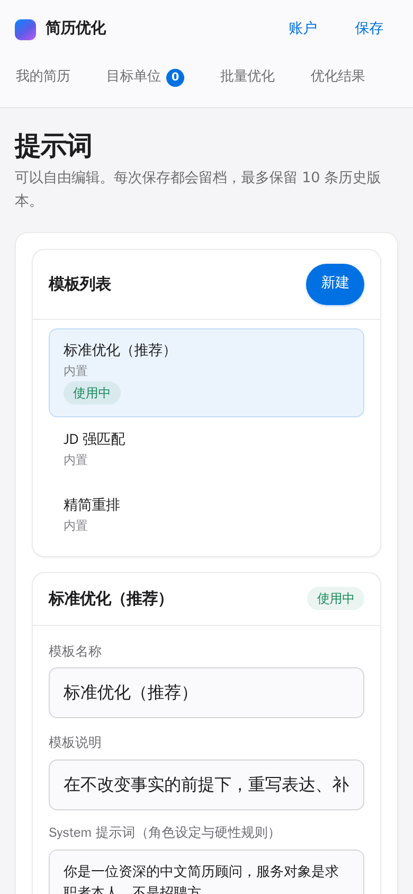
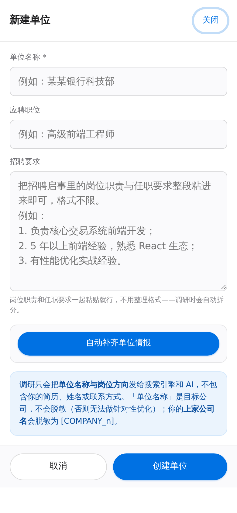

窄屏上有三类问题反复出现过，现在都进了 `test/ui.js` 的断言（390px 宽下逐页检查，
出现任何一条就判失败）：文字被压成竖排（flex 子项没设 `min-width` 时会缩成一字宽）、
相邻按钮间距小于 6px、元素横向溢出可视区。注意判断溢出**不能**用
`document.documentElement.scrollWidth`——`.sheet` 有 `overflow:hidden`，
溢出的内容会被裁掉，那个值永远是 0；要拿 `.view.active` 的边界逐元素比对。

## 单位情报是怎么来的

你只需要填**单位名称**和**招聘要求**（整段粘进去，格式不限）。其余字段由程序补齐：

```
单位名称 + 应聘职位
      ↓  3 个角度 × 2 种措辞，按相关性择优
Bing / DuckDuckGo 公开网页摘要
      ↓  有 AI 就归纳，没有就用规则归并
单位简介 · 重点考察范围 · 注意事项 · 语气偏好 · 参考来源
```

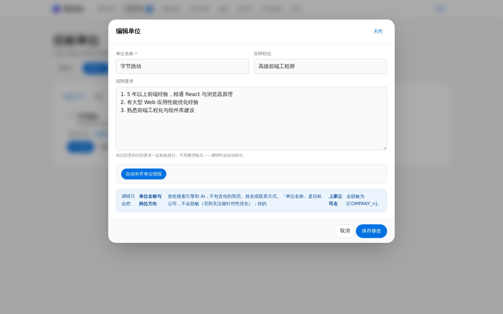
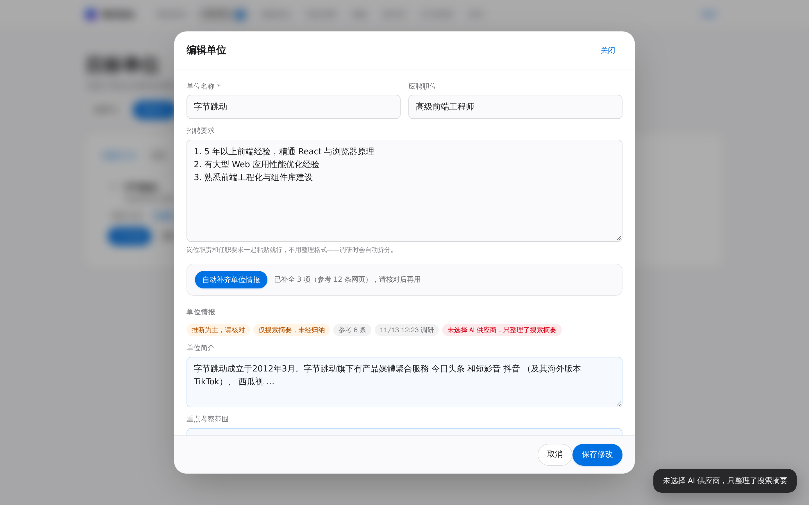

- **不只是搜一次**。搜索引擎对措辞极敏感——`字节跳动 前端工程师 面试 考察重点` 只回品牌官网，
  换成 `字节跳动 前端 面试 考察重点` 就能拿到真面经。所以每个角度备了多种措辞，
  第一条不够对题就换下一条，攒到 3 条对题材料就停（对搜索引擎限流友好）。
- **"对题"是单独判断的**。命中单位名只说明"提到了这家公司"：搜「蚂蚁集团 前端 面试」时
  必应可能只回品牌导航页，那些标题里有单位名却和面试毫无关系。这类结果不算对题，
  否则会把"其实没搜到"伪装成"搜到了"。
- **噪音一律挡在外面**。搜「美团」时 Bing 会截断成只按第一个字搜，返回「美的首页」
  「2025 年中国十大美女排行榜」。这类结果既不会进"参考来源"，也不会进 AI 的材料——
  否则 AI 会煞有介事地归纳出一家做家电的公司。判据是标题/摘要里出现完整单位名，
  面经类允许用简称（「字节前端面试全攻略」），但「中国」这种泛用前缀不放宽。
- 界面上报的是**用了多少条**，不是搜到多少条。搜到 20 条但 14 条是噪音时，写"参考 20 条"
  等于替噪音背书。
- **搜不到就说搜不到**。全都不对题时，简介写"未能获取公开资料，建议手动填写"，
  界面直接说明原因并给下一步："没搜到对口的公开资料（搜索引擎对「美团」这种短名容易只按首字
  检索，也可能只回官网导航）。可以先手动填几条重点考察范围，或换用更完整的单位名称再试一次。" 不编。
- 没有 AI 供应商时也能用：从面经摘要里挖真实考点（`涵盖事件循环、原型链、Webpack 构建优化`
  这类顿号清单会被解析出来），并明确标注**"未经 AI 归纳，请核对"**、置信度一律 low。
- 补齐的内容在弹窗里是**可改的**，机器写的字段有淡蓝底色，改完保存即覆盖。
- 批量优化时，没有情报的单位会**先自动补齐再优化**，进度条会显示"调研单位情报"。
  调研失败不会让整条优化失败，只是这次没有情报可用。

**隐私**：调研只发送单位名称与岗位方向，**从不发送简历**——`lib/research.js` 的入参里
根本没有简历对象。

## 脱敏是怎么做的

发送前把敏感值替换成稳定的占位符，返回后再换回来：

```
张伟 / 13800138000 / zhangwei@example.com / 星辰科技有限公司
        ↓  发送给 AI 的实际内容
[NAME_1] / [PHONE_1] / [EMAIL_1] / [COMPANY_1]
```

- 默认对姓名、手机号、邮箱、学校、地址、公司名、身份证号脱敏；微信、URL 默认关闭。
- 目标是**目标公司**的信息不脱敏（AI 需要知道投的是哪家公司才能对齐岗位）。
- 同一个值在整个会话里始终是同一个占位符，AI 能正确理解指代关系。
- 自定义规则支持字面量与正则两种；多条规则重叠时按"最长命中优先"，不会出现
  `数据[PLAT_1]平台` 这种切一半的结果。
- AI 若把占位符改坏（例 `[NAME_1`、`【NAME_1】`、`[ NAME 1 ]`），还原时做了容错；
  实在还原不了的会在结果页标出"检测到残留占位符"，提醒手动处理。

## 提示词模板

内置三套：标准优化（推荐）、JD 强匹配、精简重排。模板里可用变量：

```
{{companyName}} {{position}} {{companyIntro}} {{jobDuties}} {{requirements}}
{{focusAreas}} {{cautions}} {{tone}} {{resumeJson}} {{resumeText}} {{extraInstruction}}
```

系统提示词里写死了两条硬规则：不得修改方括号占位符、不得虚构经历或数字。

## AI 供应商

支持两种协议，填 Base URL 与 Key 即可：

- **OpenAI 兼容**：`baseUrl` 填到 `/v1` 为止（自动补 `/chat/completions`）。
  OpenAI、DeepSeek、Moonshot、智谱、通义、Ollama、one-api 都是这一类。
- **Anthropic**：`baseUrl` 填到域名或 `/v1` 为止（自动补 `/messages`）。

没有 Key 也能先用起来：内置「模拟器」供应商离线可用，会用规则生成一版可见的改写结果，
方便把整条流程走通。

## 目录结构

```
server.js             HTTP 服务与全部 API
lib/mask.js           脱敏引擎（区间最长优先匹配 + 容错还原）
lib/providers.js      供应商协议实现 + 离线模拟器
lib/prompts.js        模板、变量填充、历史版本
lib/optimize.js       单份简历的优化流水线
lib/render.js         HTML / Markdown 渲染
lib/themes.js         样式系统：主题 registry、设计令牌、逐段覆盖解析
lib/search.js         网页搜索：Bing / DuckDuckGo，多引擎 + 可用性嗅探
lib/research.js       单位情报：按角度择优搜集、AI 归纳、无 AI 时规则归并
lib/cssai.js          自定义 CSS 的 AI 生成：提示词、清洗（@import/外链/逃逸）、语法校验
lib/pdf/              自研 PDF 引擎：sfnt.js 字体子集化、writer.js 写 PDF、
                        resume.js 版式、index.js 入口、chrome.js 浏览器备用引擎
lib/store.js          JSON 文件存储（原子写 + 串行队列）
lib/auth.js           登录认证：scrypt 口令、签名会话、失败锁定
public/               前端（原生 ES 模块，无构建步骤；login.html 是独立的登录页）
data/                 你的数据和配置，备份这个目录即可
test/                 测试与工具脚本（fixtures/ 是真实网页快照，离线测试用）
```

## 测试

```bash
node test/e2e.js        # 118 项：登录拦截、脱敏往返、协议链路、渲染、PDF、接口、调研、持久化
node test/auth.js       # 82 项：账号初始化、登录与锁定、令牌篡改/过期/续签、改密码、HTTP 拦截
node test/style.js      # 328 项：12 套主题的结构差异、双端渲染、字号阶梯、逐段覆盖、自定义 CSS
node test/research.js   # 73 项：搜索引擎解析、相关性打分、择优停止、考点挖掘、降级路径
node test/cssai.js      # 61 项：AI 写 CSS 的清洗（@import/外链/逃逸/截断）、语法校验、提示词、真实 HTTP 链路
node test/pdf-engine.js # 127 项：字体子集、折行避头尾、10 种版式的版面不变量、文字回读
node test/pdf-layout.js out.pdf  # 单独检查某份 PDF 是否越界/重叠
node test/ui.js         # 无头浏览器逐页走查：截图、控制台报错、失败请求、390px 手机端专项
                        #（默认自起临时服务并自动登录；打已有服务时用 RESUME_USER / RESUME_PASS）
                        #（竖排文字 / 按钮过近 / 横向溢出 / 逐段箭头出界，任一出现即失败）
node test/pdf-probe.js out.pdf   # 检查 PDF 的页数、内嵌字体、页面尺寸
```

`test/e2e.js` 里的协议链路测试需要先起一个本地假上游：

```bash
node test/provider-stub.js 8899 &
node test/e2e.js
```

假上游在 8899 上同时实现 OpenAI 与 Anthropic 两种接口，并记录收到的请求，
用来验证"上游确实没收到真实姓名和手机号"。

## PDF 引擎

内置引擎在 `lib/pdf/`，四层：

| 文件 | 职责 |
| --- | --- |
| `sfnt.js` | 解析 TrueType/TTC（head/hhea/maxp/hmtx/loca/glyf/cmap），按需子集化并重编字形号 |
| `writer.js` | PDF 对象、内容流、Type0/CIDFontType2 字体、ToUnicode、Flate 压缩 |
| `resume.js` | 版式：吃 `themes.resolve()` 的结果、逐字符字体回退、折行避头尾、分页、页码、水印 |
| `index.js` | 入口：找字体、算总页数、失败时退回浏览器引擎 |

几个实现上的取舍：

- **必须子集化**。wqy-zenhei 原字体 16.7MB，不子集的话每份 PDF 都这么大；
  子集后只带实际用到的 40 来个字形，加上 Flate 压缩整份约 50KB。
- **逐字符选字体**。中文字体常常缺 `•` 这类符号，西文字体又缺全角标点；
  排每个字时先看主字体有没有这个字形，没有就换备用字体，避免出现方框。
- **宽度自己算**。PDF 里的 `/W` 数组必须和字形 advance 对得上，否则阅读器
  会排错位置（实测会导致文字压到页边距外）。`/W` 里相邻 CID 才能合并成一段，
  不相邻的必须分开写。
- **避头尾会反向影响宽度**。把标点收回上一行可能让上一行超宽，所以调整后
  要再测一次宽度，必要时把上一行末尾的字推到下一行，最后还有一道硬切兜底。

验证方式不靠肉眼：`test/pdf-layout.js` 用 pdfjs 把每份 PDF 拆成文字块，
检查越界、同行重叠、页码位置、旋转文字（水印）是否被误判，
`test/pdf-engine.js` 在这之上跑 10 种版式 × 每份 7 项断言。

## 样式系统

样式分三层，HTML 与 PDF 读同一份解析结果，所以两种输出不会各长一套样子：

1. **主题**（`lib/themes.js` 的 `THEMES`）：12 套起点，各带自己的头部样式、章节标题样式、
   条目排法、章节编号、技能形态、**圆角形态**、**章节图标**、项目符号、密度与配色。
   新增主题只改这一个文件，两个渲染器自动跟上。
2. **逐段覆盖**（`settings.export.layout.sections`）：每一块可以单独改标题文字、标题样式、
   位置（上方/左侧）、对齐、项目符号、**条目排法**、**章节编号**、**章节图标**、字号倍率、是否显示，以及整体顺序。
   换主题时会清空这些覆盖，避免旧主题的微调把新主题改坏。
3. **自定义 CSS**（`layout.customCSS`）：追加在主题样式之后，直接生效。

十二套主题不只是换颜色——头部、章节标题、**条目排法**、编号、技能形态、**圆角**、**图标**七件事一起换：

| id | 名字 | 头部 | 章节标题 | 条目排法 | 编号 | 技能 | 圆角 | 图标 |
| --- | --- | --- | --- | --- | --- | --- | --- | --- |
| `aurora` | 晨曦渐变 | 渐变横幅 | 字距小标 | 上下堆叠 | — | 文字行 | 大圆角 | — |
| `editorial` | 杂志侧栏 | 细线 | 左侧栏 | 时间靠右 | — | 文字行 | 直角 | 短竖线 |
| `timeline` | 时间线 | 细线 | 左竖条 | 时间在上 + 竖线 | — | 文字行 | 小圆角 | 实心圆 |
| `spotlight` | 海报大标题 | 居中大字 | 字距小标 | 时间靠右 | 01 | 标签 | 直角 | 空心环 |
| `classic` | 经典衬线 | 细线 | 下划线 | 上下堆叠 | 一、 | 文字行 | 直角 | — |
| `modern` | 现代卡片 | 纯文字 | 色块 | 色条卡片 | — | 标签 | 小圆角 | 方块 |
| `minimal` | 极简黑白 | 纯文字 | 细分隔线 | 时间靠右 | — | 文字行 | 直角 | — |
| `compact` | 紧凑一页 | 细线 | 色块 | 时间靠右 | — | 文字行 | 小圆角 | 菱形 |
| `ivory` | 象牙留白 | 居中大字 | 字距小标 | 时间在上 | 01 | 标签 | 直角 | 菱形 |
| `coral` | 珊瑚活力 | 渐变横幅 | 色块 | 色条卡片 | — | 标签 | 全圆角 | 实心圆 |
| `slate` | 石板极简 | 纯文字 | 左竖条 | 时间在上 + 竖线 | — | 文字行 | 直角 | 短竖线 |
| `grid` | 网格秩序 | 细线 | 下划线 | 时间靠右 | — | 标签 | 小圆角 | 方块 |

圆角与图标都是**真的画出来**的，不是改个 class：HTML 用内联 SVG，PDF 用 PDF 的路径指令
（`roundRect` 四段三次贝塞尔 + `poly` 多边形），两端的形状一一对应。图标与标题文字之间
留了 `.5em` 的间距，序号也一样——贴在一起会读成「一、」和标题是同一个词。

四种条目排法的区别是 DOM 层面的，不是只加一个 class：

```
stack   单位 · 职位                2021-03 – 至今
inline  单位 · 职位 · 2021-03 – 至今         ← 时间跟在后面，不推到右边缘
block   2021-03 – 至今                        ← 时间独占一行压在上方
        单位 · 职位
card    ┌▌单位 · 职位            2021-03 – 至今   ← 浅底 + 左侧色条
        └▌· 做了什么
```

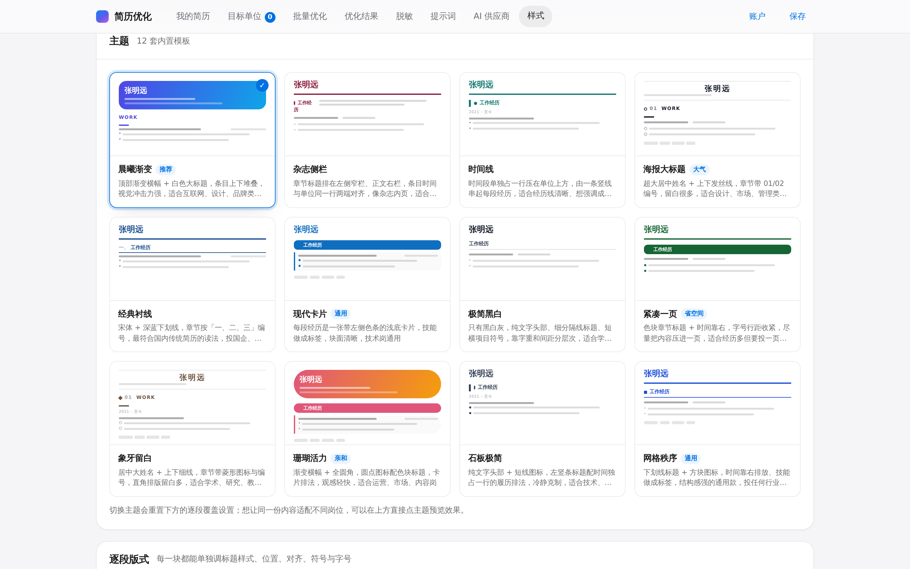

### 用一句话生成 CSS

「样式 → 自定义 CSS」里第一块是 AI 输入框:写清想要的效果(「标题做得像杂志,左边加一条
细竖线;条目之间再紧凑一点」),点「生成 CSS」,生成的样式会**回填到下面的编辑器并立刻
更新右侧预览**。第二个按钮「在此基础上调整」会把当前 CSS 一起发给模型,适合小步微调;
生成后出现「撤销生成」,一键退回上一版。

几件默认做掉的事:

- 模型只能看到**结构说明 + 可用 CSS 变量清单**,拿不到你的简历内容——和单位情报一样,
  简历原文不出本机。
- 输出先清洗再落地:去掉 \`\`\`css 围栏、去掉 @import 与外链 url()、去掉 \`</style>\`
  一类的逃逸写法、超长截断,并做括号配平校验;校验不过就直接报错,**绝不静默覆盖**你现有
  的 CSS(坏 CSS 只会让简历变丑,所以宁可什么都不改)。
- 提示词里写明了主题规则的**优先级陷阱**:主题多用 `.head--band .name` 这类两级选择器,
  所以让它写 `.head .name`、`.sec .sec-title`,而不是光写 `.name` ——否则样式会被主题压住,
  看起来像「AI 生成没生效」。
- 「模拟供应商」不算可用供应商:它不会真的写 CSS,这时按钮是禁用的,并提示你去「供应商」页
  配一个真实模型。

```
POST /api/css/generate  { prompt, current?, theme? }  →  { ok, css, warnings, provider, model, elapsedMs }
                       400 空描述 / 400 没有可用供应商 / 422 生成的不是合法 CSS / 502 上游报错
```

### 色块标题为什么不偏上

`modern` / `coral` / `compact` 三套的章节标题是色块。色块高 **1.5em**(上下内边距 `.18em`
+ 行高 `1.14em`),文字在色块里垂直居中——**不是靠 `line-height` 撑出来的**。早先写的是
`line-height:1.6` + `padding:.2em`,色块被撑到 2em 高:13px 的字装在 27px 的块里,上下各
空 7px,看起来就像「顶部空了一整个字」。现在色块高度是字号的 1.5 倍,字占掉三分之二,
实测上下留白 3–4px、左右差 1px 以内。

同一个改动里还修了两处:**色块里的图标改成白色**(原来是 accent 色画在 accent 底上,
等于隐身),图标和文字一样吃色块内边距;HTML 用 `min-height` + padding 而不是写死
`height`,标题被改长折行时色块会自己长高,不会把字漏到色块外面。PDF 端按同一套尺寸画
(`h = sizePx * 1.5`),两端墨迹位置一致。

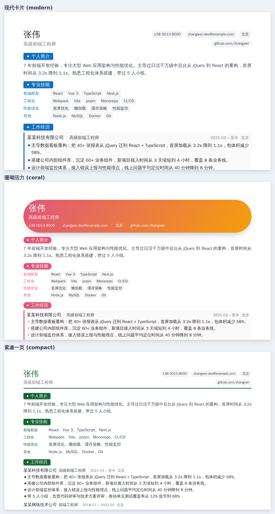

### 字号阶梯与间距

之前 HTML 和 PDF 各写一套字号倍率（名字 1.82×、横幅 2×、居中 2.2×），改一处忘另一处就会
出现「预览好看、导出挤成一团」。现在两个渲染器都从 `themes.metrics()` 取同一份数值，
换算成 `--m-name` / `--m-section` / `--m-section-gap` 这样的 CSS 变量：

| 令牌 | 含义 | 默认值（aurora） |
| --- | --- | --- |
| `--m-name` | 姓名 | 正文 2.02×（居中排版 2.28×） |
| `--m-title` | 职位 | 1.04× |
| `--m-section` | 章节标题 | 1.02× |
| `--m-org` / `--m-role` | 单位 / 职位 | 1.04× / 0.96× |
| `--m-meta` | 时间、地点、技术栈 | 0.88× |
| `--m-eyebrow` | 字距小标 | 0.84× |
| `--m-section-gap` | 章节间距 | 间距基准的 1.26× |
| `--m-indent` | 项目符号悬挂缩进 | 正文 0.98× |

间距同样按一个基准缩放（`--gap` = 11px × 主题密度），而不是各自随手加几像素——
这样八个主题的「呼吸感」才是同一种节奏，换主题不会觉得松紧忽然变了。

改字号或行高时，整张简历会等比缩放：名字仍然最重、注释仍然最小，层级不会塌。

自定义 CSS 的可用选择器与变量写在 `lib/render.js` 文件头，页面上「样式 → 自定义 CSS」
里也有一份折叠速查。注意：**写了自定义 CSS 时导出 PDF 会自动改用本机 Chrome 渲染**
——内置引擎只认设计令牌，读不懂选择器，与其悄悄忽略你的样式，不如换引擎真正应用。
装不上 Chrome 的机器上会退回内置引擎并忽略这段 CSS，HTML 导出不受影响。

浏览器引擎常驻一个 Chrome 实例。这个实例如果被系统 OOM 掉、或被人手动 kill，下次导出会
自动发现连接已断、丢掉旧实例重新拉起，不用重启服务；每个进程还各用一份独立的
`--user-data-dir`，所以同时跑着自测脚本或命令行导出时不会互相把对方的浏览器顶掉。

## 数据备份

`data/` 下六个 JSON 就是全部状态。直接复制走即可：

```
profile.json   简历内容
companies.json 目标单位
jobs.json      优化任务与结果
settings.json  脱敏开关、自定义规则、导出设置
prompts.json   提示词模板与历史版本
providers.json 供应商配置（含 API Key，注意保管）
```
